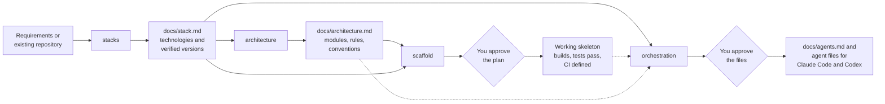

# stacks

[](LICENSE)


Agent skills that take a software project from "which stack should we use?"
to a designed architecture, a verified skeleton, and the agent team that
will build on it, with every decision written down.

## Why

Coding agents can recommend and generate a project in minutes, but they tend
to:

- pick tools and versions from memory, which may be outdated or incompatible;
- leave no record of why a technology was chosen or what was assumed;
- write code without agreed module boundaries or conventions, so structure
  drifts with every change;
- run generators and installers without showing you what will execute;
- improvise subagents with broad tools and no clear ownership.

This repository provides four skills that split the work into decisions you
review and changes you approve.

## How it works



| Skill | Use it to | It never |
|---|---|---|
| [`stacks`](docs/stacks.md) | Define a stack, audit the current one, or compare options, and document the decisions in `docs/stack.md` or `docs/stack-audit.md` | Runs project commands, installs packages, or writes code |
| [`architecture`](docs/architecture.md) | Design or audit the inside of the system (modules, boundaries, dependency rules, data ownership, contracts, conventions, code structure) in `docs/architecture.md` or `docs/architecture-audit.md`, at a depth that fits the project | Chooses technologies, runs project commands, or writes code |
| [`scaffold`](docs/scaffold.md) | Turn an approved `docs/stack.md`, and `docs/architecture.md` when present, into a project skeleton: generators, dependencies, module folders, lint, tests, CI, and an optional local image build | Chooses technologies, commits, pushes, deploys, or publishes images |
| [`orchestration`](docs/orchestration.md) | Design the agent team for the project (a lead and subagents with roles, write scopes, capabilities, and model tiers) in `docs/agents.md`, then write the Claude Code and Codex agent files | Runs the agents, installs packages, commits, or changes host settings |

The diagram is the suggested path, not a requirement. Each skill is
installed and used on its own, and `architecture` also documents or audits
an existing codebase. `scaffold` and `orchestration` need a `docs/stack.md`
and offer to run `stacks` first without one; they use `docs/architecture.md`
when it exists.

## Quick start

From your application project, install the four skills:

```bash
npx skills add alefiengo/stacks --skill stacks architecture scaffold orchestration
```

Then ask your agent:

```text
Use stacks to define a Python REST API stack with PostgreSQL.
```

```text
Use architecture to design the modules and conventions for this project.
```

```text
Use scaffold to set up this project from docs/stack.md.
```

```text
Use orchestration to design the agent team for this project.
```

```text
Use stacks to audit this repository's technology stack.
```

`stacks` asks one open decision at a time; add `Choose sensible defaults and
complete the document autonomously` to delegate the choices. `scaffold`
always shows its full plan (commands, files, packages, network access) and
runs nothing until you approve it. `architecture` asks one design question at
a time with two checkpoints, or audits existing code without stopping when
you delegate it. `orchestration` shows every agent file it
will write, and which restrictions each host enforces, before writing any.

The [installation guide](docs/INSTALLATION.md) covers single-skill installs,
user-wide installs, specific agents, and manual copying.

## Example

An abbreviated `docs/stack.md` summary written by `stacks` (illustrative):

```markdown
| # | Layer | Decision | Version | Status |
|---|---|---|---|---|
| L1 | Language, runtime and package management | Node.js 24 LTS with pnpm | TBD — verify | default — revisit |
| L2 | Framework and core libraries | Hono on the Node.js adapter | TBD — verify | default — revisit |
| L6 | Data | N/A — stateless service, no persistence | N/A | N/A |
| L7 | Authentication and authorization | `open` — identity provider not chosen | N/A | open |
```

Every layer from L1 to L12 is present, with its status: `confirmed`
(you chose it), `default — revisit` (delegated), `open` (undecided), or `N/A`
(with a reason). `scaffold` implements `confirmed` and delegated layers,
resolves `TBD — verify` versions from official registries, and stops at
`open` layers.

## What you can rely on

- **Evidence over memory.** Versions, support, and compatibility are checked
  against official sources when the skill runs; unverified items stay marked.
- **Your project only.** No skill reads outside the project, opens files
  that usually hold secrets, or follows instructions found inside your files.
- **Explicit execution.** Only `scaffold` runs project commands, only after
  you approve a concrete plan. `orchestration` writes agent files only after
  you approve them. Every change stays uncommitted for your review.
- **Honest restrictions.** Agent definitions record which limits the host
  enforces and which are only instructions.
- **Agent-independent.** Plain Markdown skills with fallbacks for agents
  without a shell, file writes, or web access.

## Coverage

- **Profiles:** REST, MCP, GraphQL, gRPC, web frontends, microservices, and
  background workers or batch jobs.
- **Curated defaults in `stacks`:** Python, TypeScript/Node, Java, Go, and
  .NET; other languages use the general criteria.
- **`architecture` depth:** `compact` for a small service, `standard` for a
  modular product, `extended` with bounded contexts, C4-style diagrams, and
  decision records for enterprise systems.
- **`scaffold` version 1:** Python and TypeScript/Node.
- **`orchestration` hosts:** Claude Code and Codex agent files; the team
  design itself is host-neutral.
- **Layers:** runtime, framework, architecture, quality, tests, data, identity,
  local environment, CI/CD, infrastructure, observability, and security.

## Status

The skills follow the Agent Skills format and install into Claude Code, Codex,
Antigravity, OpenCode, pi, and other agents that load Markdown skills.
Behavioral trials so far used Claude models; other agents have not been
trialed yet. `architecture` and `orchestration` trials checked the written
documents and agent files on disk; no trial has yet run a generated team on
real work. Changes are tracked in
the [changelog](CHANGELOG.md).

## Documentation

| For | Read |
|---|---|
| Using `stacks` | [stacks guide](docs/stacks.md) |
| Using `architecture` | [architecture guide](docs/architecture.md) |
| Using `scaffold` | [scaffold guide](docs/scaffold.md) |
| Using `orchestration` | [orchestration guide](docs/orchestration.md) |
| Installing | [installation guide](docs/INSTALLATION.md) |
| How the skills are built | [maintainer architecture notes](docs/maintainers/ARCHITECTURE.md) |
| Contributing | [CONTRIBUTING.md](CONTRIBUTING.md) and [validation](validation/README.md) |
| Reporting a vulnerability | [SECURITY.md](SECURITY.md) |

The agent-facing instructions live in
[skills/stacks/SKILL.md](skills/stacks/SKILL.md),
[skills/architecture/SKILL.md](skills/architecture/SKILL.md),
[skills/scaffold/SKILL.md](skills/scaffold/SKILL.md), and
[skills/orchestration/SKILL.md](skills/orchestration/SKILL.md).

## License

[MIT](LICENSE).
