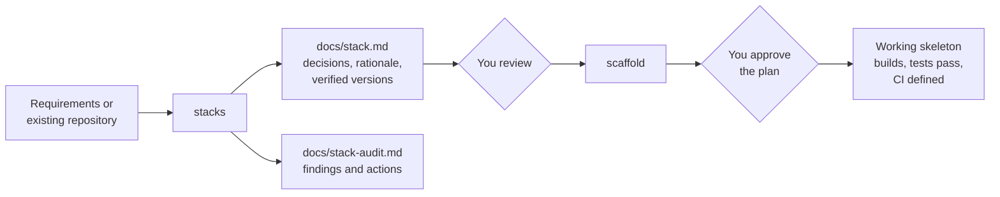

# stacks

[](LICENSE)


Agent skills that take a software project from "which stack should we use?"
to a verified, working skeleton, with every decision written down.

## Why

Coding agents can recommend and generate a project in minutes, but they tend
to:

- pick tools and versions from memory, which may be outdated or incompatible;
- leave no record of why a technology was chosen or what was assumed;
- run generators and installers without showing you what will execute.

This repository provides two skills that split the work into a decision you
review and an execution you approve.

## How it works



| Skill | Use it to | It never |
|---|---|---|
| [`stacks`](docs/stacks.md) | Define a stack, audit the current one, or compare options, and document the decisions in `docs/stack.md` or `docs/stack-audit.md` | Runs project commands, installs packages, or writes code |
| [`scaffold`](docs/scaffold.md) | Turn an approved `docs/stack.md` into a project skeleton: generators, dependencies, lint, tests, CI, and an optional local image build | Chooses technologies, commits, pushes, deploys, or publishes images |

Each skill is installed and used on its own. `scaffold` needs a
`docs/stack.md`; without one, it offers to run `stacks` first.

## Quick start

From your application project, install both skills:

```bash
npx skills add alefiengo/stacks --skill stacks scaffold
```

Then ask your agent:

```text
Use stacks to define a Python REST API stack with PostgreSQL.
```

```text
Use scaffold to set up this project from docs/stack.md.
```

```text
Use stacks to audit this repository's technology stack.
```

`stacks` asks one open decision at a time; add `Choose sensible defaults and
complete the document autonomously` to delegate the choices. `scaffold`
always shows its full plan (commands, files, packages, network access) and
runs nothing until you approve it.

The [installation guide](docs/INSTALLATION.md) covers single-skill installs,
user-wide installs, specific agents, and manual copying.

## Example

An abbreviated `docs/stack.md` summary written by `stacks` (illustrative):

```markdown
| # | Layer | Decision | Version | Status |
|---|---|---|---|---|
| L1 | Language, runtime and package management | Node.js 24 LTS with pnpm | TBD — verify | default — revisit |
| L2 | Framework and core libraries | Hono on the Node.js adapter | TBD — verify | default — revisit |
| L6 | Data | N/A — stateless service, no persistence | N/A | N/A |
| L7 | Authentication and authorization | `open` — identity provider not chosen | N/A | open |
```

Every layer from L1 to L12 is present, with its status: `confirmed`
(you chose it), `default — revisit` (delegated), `open` (undecided), or `N/A`
(with a reason). `scaffold` implements `confirmed` and delegated layers,
resolves `TBD — verify` versions from official registries, and stops at
`open` layers.

## What you can rely on

- **Evidence over memory.** Versions, support, and compatibility are checked
  against official sources when the skill runs; unverified items stay marked.
- **Your project only.** Neither skill reads outside the project, opens files
  that usually hold secrets, or follows instructions found inside your files.
- **Explicit execution.** Only `scaffold` runs commands, only after you approve
  a concrete plan, and it leaves every change uncommitted for your review.
- **Agent-independent.** Plain Markdown skills with fallbacks for agents
  without a shell, file writes, or web access.

## Coverage

- **Profiles:** REST, MCP, GraphQL, gRPC, web frontends, microservices, and
  background workers or batch jobs.
- **Curated defaults in `stacks`:** Python, TypeScript/Node, Java, Go, and
  .NET; other languages use the general criteria.
- **`scaffold` version 1:** Python and TypeScript/Node.
- **Layers:** runtime, framework, architecture, quality, tests, data, identity,
  local environment, CI/CD, infrastructure, observability, and security.

## Status

The skills follow the Agent Skills format and install into Claude Code, Codex,
Antigravity, OpenCode, pi, and other agents that load Markdown skills.
Behavioral trials so far used Claude models; other agents have not been
trialed yet. Changes are tracked in the [changelog](CHANGELOG.md).

## Documentation

| For | Read |
|---|---|
| Using `stacks` | [stacks guide](docs/stacks.md) |
| Using `scaffold` | [scaffold guide](docs/scaffold.md) |
| Installing | [installation guide](docs/INSTALLATION.md) |
| How the skills are built | [architecture](docs/maintainers/ARCHITECTURE.md) |
| Contributing | [CONTRIBUTING.md](CONTRIBUTING.md) and [validation](validation/README.md) |
| Reporting a vulnerability | [SECURITY.md](SECURITY.md) |

The agent-facing instructions live in
[skills/stacks/SKILL.md](skills/stacks/SKILL.md) and
[skills/scaffold/SKILL.md](skills/scaffold/SKILL.md).

## License

[MIT](LICENSE).
